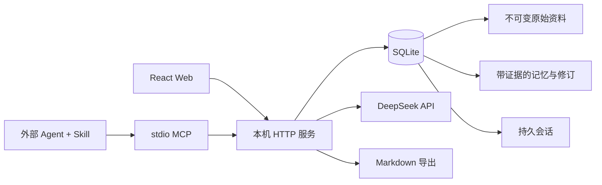

# 星汐 0.1 架构

## 作用域与事实层

`spaces.kind` 为 work / companion。所有源、条目、关系和会话均显式指定 space_id。接口解析空间后，每次对象查询仍检查其空间归属，禁止通过另一空间 ID 引用对象。跨空间引用在写入时也被拒绝。

数据表：spaces、sources、entries、revisions、relations、sessions、messages、jobs、entry_terms、migrations、space_memory、session_memory、session_bindings，以及 FTS5 conversation_search、catalog_search、稳定目录映射 catalog_docs 、来源字数缓存 source_metrics 及回答参考表 reply_evidence / reply_evidence_items。外键开启，WAL 日志模式。每次条目编辑传入 revision；版本不符返回 409。更新前将旧条目写入 revisions，同一事务提交。

来源的正文不可通过服务 API 修改。记忆包含一组 `{sourceId, quote}`，每个 quote 必须是同空间来源原文的连续子串。候选状态 pending，经界面确认成为 accepted；归档为 archived。context_get 只检索 accepted。出处匹配检查提供可追溯性，不能替代对总结正确性的审核。

## 编译任务

资料提炼创建 queued 任务并进入单服务串行队列。同一来源已有活动任务时返回原任务。模型只能返回最多 8 条候选，逐条进行结构和引用校验；任意条失败全部回滚。不会修改已有已确认条目。服务重启将残余 queued / running 标记 failed，用户可重试。队列是进程内的；请勿多实例共享一个数据目录。

## 会话协议

session_read 默认按 rowid 游标返回最近最多 100 条，使用 nextBefore 继续向前读取。每轮上下文直接查询最近 20 条，追加消息仅校验会话元数据。收为资料由服务端读取完整消息，超过导入长度上限则明确拒绝。

session_create 返回持久 ID；调用者在后续使用相同 ID。session_append 用 `(session_id,client_id)` 唯一约束去重；相同标识不同内容返回 409。

chat_reply 先检查 Key 和会话，再保存用户消息，生成回答后写入 `reply:{clientId}`。失败保留用户消息，重试复用标识。单会话进程内锁防止重叠生成；重复成功请求直接返回原答案。来源和会话内容以数据引用方式放入模型上下文，不授予执行工具权限。

## 检索

英文完整单词/数字与中文连续文本的双字组构成查询项，单字查询使用单字索引。`entry_terms` 是可重建的持久倒排索引，确认、编辑、归档时在同一事务内维护。标题匹配得 3 分，正文 1 分；无匹配则不召回，不伪造相关结果。空查询返回最近已确认条目。对话额外加入当前空间最近确认的 preference/agreement，最多合并 8 条。最多保留最近 20 条消息，总字符预算约 20,000。当前实现没有 embedding 与长期滚动摘要。

聊天全文索引仅对用户原话做中文单字/双字和英文分词，在消息写入的同一事务更新。查询通过空间专用 token 在 FTS5 内限定作用域，再以数据库归属复核；最多检索 6 条相关原话和 2 条近期原话，排除已经在当前窗口里的消息，单条原文摘录不超过 1,200 字符。没有后台模型摘要调用。会话/空间开关在查询时生效，删除消息的触发器同步清理索引。首次升级在事务中回填已有用户消息，migrations 标记避免重复回填。

`session_open` 用 `(space_id,binding)` 唯一约束恢复会话，绑定和新会话创建在同一事务。删除会话会清除关联绑定；已有手动资料快照保留。模型回复期间拒绝删除会话。`session_list` 采用 rowid 游标每页最多 100 条。

## 回答参考记录

Service 在模型调用前截取实际输入：最多 8 条知识的标题、版本、1,600 字符正文及每出处 500 字符摘录，最多 8 条 1,200 字符历史用户原话，实际进入字符预算的最多 20 条近期消息标识/角色/时间。模型成功后，回答与这些记录在同一事务提交；失败不伪造参考记录，重试读取已经保存的记录，不再调用模型。

网页在点击「本轮参考」时调用 `GET /api/spaces/:sid/sessions/:sessionId/messages/:messageId/evidence`；MCP `chat_evidence` 使用同一接口。接口校验空间、会话和消息归属，不把全部参考内容混入会话列表。旧消息与 session_append 的外部消息没有当时生成信息，返回 recorded=false。

知识展示当时的有限快照，并标记已更新或归档；近期上下文仅记录标识，不复制全文。原会话删除通过数据库触发器将其他参考项 payload 清空，删除回答则外键级联移除其整份记录。保存时再次查验目标存在，避免模型生成过程中删除的原话被写回。关闭空间/会话召回后，读取时隐藏相关原话；这些审计数据永不进入记忆检索。已经输出的回答、手工资料和备份不因原会话删除而自动改写。

## 按需页面与目录全文索引

`GET /api/spaces/:sid/view?view=graph|book|timeline|workshop|chat` 为网页入口，不调用旧的完整 snapshot。每页分别限制 160 个节点/500 条边、60 条知识摘要、40 个时间事件、50 份来源元数据、50 个会话。知识摘要只含最多 240 字符 preview 和证据数量；完整正文、证据、来源标题与邻居通过 `/entries/:id/detail` 读取。相邻关系每批 50 条，可继续分页。

目录索引 catalog_search 覆盖所有状态的标题与正文，使用多词 AND 匹配；查询复核空间和状态，不改变模型只召回 accepted 知识的约束。catalog_docs 为每条知识提供独立整数文档 ID，避免依赖 entries 的隐式 rowid。新增、修订与索引更新在同一事务中，嵌套操作使用 SAVEPOINT，兼容整个提炼任务的回滚。

知识与来源采用时间和 UUID 的复合游标；星历分别从两个有序索引各取最多 41 条元数据，再合并成 40 条。同一时间戳仍按 ID 稳定翻页；正在变化的数据可能移入更新页面，不是审计快照。

全空间计数使用覆盖索引。来源字符数在写入时由数据库触发器更新到 source_metrics，浏览时不再重复对长正文执行 length()。前端搜索延迟 250 ms，过期请求不会覆盖新空间、页面或筛选；编辑弹窗保存打开时的 revision，后台刷新不能放宽并发冲突检查。

## 备份与恢复

`Backups` 控制器一次运行一个页面任务；`backup-worker.mjs` 在独立工作线程调用 Node SQLite online backup、流式 SHA-256 和整库校验。源连接只读，副本转换为无 WAL 依赖的数据库，最后写清单后才在列表发布。记录不含模型配置或令牌文件。备份与全量校验不占主服务 JavaScript 线程，但仍与读写竞争磁盘；其他连接频繁写入可能导致复制重试。

恢复只创建全新目录，先校验复制后的临时文件，再改名为 xingxi.sqlite；无法覆盖已有目录或运行实例。结构与新建空库的已知结构比对，拒绝额外触发器；校验完整性、外键和聊天 FTS 行号/作用域对应。SQLite 在线备份保留隐式 rowid，恢复后的 UUID、分页序号与会话绑定均有回归验证。首次启动生成新访问令牌，需重新配置 Key，MCP 显式切换到新目录与端口。

`/api/backups` 及检查/恢复接口使用现有本机认证与跨站限制，只接受受控备份 ID，不接受任意源/目标路径。CLI 支持用户指定的新目录。任务超时不报告成功，需检查是否已生成完整清单，强制退出可能留下未完成目录。备份是独立历史快照；删除当前数据不会自动擦除备份。操作与当前版本恢复限制见 docs/BACKUP.md。

## 入口与认证

默认 HTTP 绑定 127.0.0.1:4180。访问首页写入 HttpOnly / SameSite Strict cookie；API 可用该 cookie 或 Bearer token。未知 Host、跨域 Origin 和 cross-site 请求被拒绝，无宽松 CORS。MCP 从本机配置目录读取访问令牌，只支持 localhost / 127.0.0.1 HTTP。令牌持有者拥有整个本机实例权限；这是单用户软件，不是多租户服务。

生产静态界面设定 CSP；ReactMarkdown 不启用原始 HTML。API 错误不返回堆栈、密钥或模型原始错误响应。模型调用固定官方 DeepSeek 地址；90 秒超时，HTTP 401/402/429 转换成可操作的错误。Key 存在本机权限 0600 文件中，状态接口只返回 configured/model/provider。

## 后续演进应保留的约束

1. 引入向量或图索引后，SQLite/原文仍保留来源，索引应可重建。
2. 文件夹双向 Wiki 同步需要独立冲突协议，不能直接覆盖来源层。
3. 自动记忆抽取只能先产生候选，不能把模型推测当成用户陈述。
4. 外部 Agent 是否提交会话由用户和适配器决定，MCP 无法自动获取宿主历史。
5. 主动交流应有用户配置的频率、静默时间和关闭开关；不得伪称执行了实际未发生的操作。

## 持续完善验收清单

本轮已验证：网页/MCP 共用会话与原话索引、固定绑定恢复、跨会话召回、原话来源查看、空间与会话关闭开关、删除清理、旧库升级、模型与 MCP 拒绝重定向。

尚待完成的目标项（不能据当前测试宣称“完美版本”）：

- 已完成：网页使用按页面摘要与分页接口，完整正文只在点击时读取；兼容完整快照仅保留作旧接口、诊断和导出使用。
- 长会话的主题与助手方案仍缺乏有出处的滚动摘要；现有自动记忆为用户原话召回，不能代替全历史理解。
- 记忆冲突、时间变更和用户纠正需要可审阅的统一管理；当前仅保留原话时间并提示模型优先当前纠正。
- 已完成：每轮参考记录持久化，Web/MCP 同源读取，删除传播与有界读取；通过重启、回滚、真实模型及 5,000 份记录性能验收。
- 已完成：在线备份、校验、独立副本恢复、凭证文件排除与恢复后会话/索引/绑定/参考记录核对。
- 尚待完善：长摘要和冲突审阅，以及相应性能、外发边界与真实模型回归。
