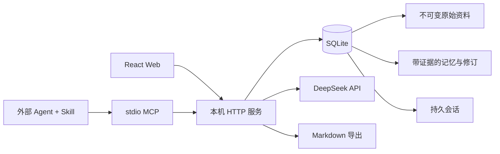

# 星汐 0.1 架构

## 作用域与事实层

`spaces.kind` 为 work / companion。所有源、条目、关系和会话均显式指定 space_id。接口解析空间后，每次对象查询仍检查其空间归属，禁止通过另一空间 ID 引用对象。跨空间引用在写入时也被拒绝。

数据表：spaces、sources、entries、revisions、relations、sessions、messages、jobs。外键开启，WAL 日志模式。每次条目编辑传入 revision；版本不符返回 409。更新前将旧条目写入 revisions，同一事务提交。

来源的正文不可通过服务 API 修改。记忆包含一组 `{sourceId, quote}`，每个 quote 必须是同空间来源原文的连续子串。候选状态 pending，经界面确认成为 accepted；归档为 archived。context_get 只检索 accepted。出处匹配检查提供可追溯性，不能替代对总结正确性的审核。

## 编译任务

资料提炼创建 queued 任务并进入单服务串行队列。同一来源已有活动任务时返回原任务。模型只能返回最多 8 条候选，逐条进行结构和引用校验；任意条失败全部回滚。不会修改已有已确认条目。服务重启将残余 queued / running 标记 failed，用户可重试。队列是进程内的；请勿多实例共享一个数据目录。

## 会话协议

session_create 返回持久 ID；调用者在后续使用相同 ID。session_append 用 `(session_id,client_id)` 唯一约束去重；相同标识不同内容返回 409。

chat_reply 先检查 Key 和会话，再保存用户消息，生成回答后写入 `reply:{clientId}`。失败保留用户消息，重试复用标识。单会话进程内锁防止重叠生成；重复成功请求直接返回原答案。来源和会话内容以数据引用方式放入模型上下文，不授予执行工具权限。

## 检索

英文单词/数字与中文连续文本的双字组构成查询项。标题匹配得 3 分，正文 1 分；无匹配则不召回，不伪造相关结果。空查询返回最近已确认条目。对话额外加入当前空间最近确认的 preference/agreement，最多合并 8 条。最多保留最近 20 条消息，总字符预算约 20,000。当前实现没有 embedding 与长期滚动摘要。

## 入口与认证

默认 HTTP 绑定 127.0.0.1:4180。访问首页写入 HttpOnly / SameSite Strict cookie；API 可用该 cookie 或 Bearer token。未知 Host、跨域 Origin 和 cross-site 请求被拒绝，无宽松 CORS。MCP 从本机配置目录读取访问令牌，只支持 localhost / 127.0.0.1 HTTP。令牌持有者拥有整个本机实例权限；这是单用户软件，不是多租户服务。

生产静态界面设定 CSP；ReactMarkdown 不启用原始 HTML。API 错误不返回堆栈、密钥或模型原始错误响应。模型调用固定官方 DeepSeek 地址；90 秒超时，HTTP 401/402/429 转换成可操作的错误。Key 存在本机权限 0600 文件中，状态接口只返回 configured/model/provider。

## 后续演进应保留的约束

1. 引入向量或图索引后，SQLite/原文仍保留来源，索引应可重建。
2. 文件夹双向 Wiki 同步需要独立冲突协议，不能直接覆盖来源层。
3. 自动记忆抽取只能先产生候选，不能把模型推测当成用户陈述。
4. 外部 Agent 是否提交会话由用户和适配器决定，MCP 无法自动获取宿主历史。
5. 主动交流应有用户配置的频率、静默时间和关闭开关；不得伪称执行了实际未发生的操作。
