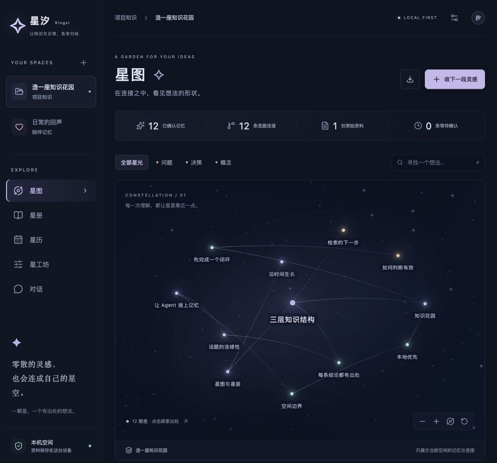

# 星汐 · Xingxi

一处本机运行的知识与记忆空间：把项目资料编成可追溯的 Wiki，也给日常对话留下一段连续的记忆。

> **派生说明**：本项目的星点纹理和透视投影代码派生自 [星汐 dsh-xingxi](https://github.com/Yuuyuko-uu/dsh-xingxi)，原作者 **Yuuyuko-uu**，Copyright (c) 2026。星汐新增了独立 React 界面、工作/陪伴空间、SQLite 数据层、资料提炼与审阅、持久会话及 MCP 服务。完整发行版遵循 **Yuuyuko-uu 插件许可 1.1**，见 [LICENSE](LICENSE)、[NOTICE](NOTICE)；该自定义许可不应表述为 MIT 或其他 OSI 标准开源许可。



## 启动

需要 Node.js **22.16+（22.x）或 24+**（推荐 Node 24 LTS）及 npm。首次安装需要网络。

```sh
npm ci
npm run build
npm start
```

打开 **http://127.0.0.1:4180/**。开发时运行 `npm run dev`，修改后刷新页面。服务只监听本机回环地址；首版不支持直接暴露公网或多人使用。

首次启动会建立两个标明「示例」的空间。所有资料、偏好和对话片段都是虚构示例，不来自任何实际 QQ、B 站或其他聊天记录。点击空间列表旁的 **＋**，创建自己的空白项目或陪伴空间。当前优先支持 PC 桌面使用。

## 这一版可以做什么

- **星图**：浏览记忆及手工定义的关系，按类型或关键词筛选，缩放、旋转、查看出处。
- **星册**：每页 60 条摘要、全文关键词检索、点击读取完整条目；支持编辑、确认候选、归档、历史版本和带来源的 Markdown 导出。
- **星历**：每页 40 个资料与记忆更新事件，打开条目回看历史版本。
- **星工坊**：导入文字 / Markdown / TXT，手工整理或调用 DeepSeek 提炼，编辑空间专属对话设定。
- **对话**：自动保存多个持久会话，结合当前空间已确认记忆、相关历史用户原话与最近消息回复；可查看召回出处、关闭聊天记忆或删除会话。
- **MCP**：让其他 Agent 检索知识、提交资料与候选、继续星汐的同一段会话。

未配置 Key 时，导入、手工整理、确认、关系、检索、阅读和导出都能使用。提炼与 AI 对话需要在星工坊填写 **自己的 DeepSeek API Key**。默认模型 `deepseek-flash`，可切换 `deepseek-v4-pro`。接口固定为 DeepSeek 官方地址，不向任意自定义服务发送 Key。模型可用性取决于 DeepSeek 账户与服务；[官方模型说明](https://api-docs.deepseek.com/quick_start/pricing/)。

### 第一个知识闭环

1. 新建一个项目空间，点击「收下一段灵感」，导入资料原文。
2. 在工坊点击「手动整理」或「提炼」。手动整理需粘贴原文中的连续摘录。
3. 到星册的「待确认」里核对正文和出处，点击「确认记忆」。
4. 在星图查看、建立思路连接，或在对话中询问相关内容。
5. 结论变化时编辑保存新版本；失效的内容归档后不再进入检索。

**“摘录存在”不等于“结论必然正确”**：服务会验证摘录是否确实来自本空间原文，语义准确性仍由用户在确认时检查。模型不会自动将候选升级为长期记忆。

页面按需读取：各页面分别取当前页数据，完整正文与来源在点击后加载。知识搜索覆盖当前空间的完整正文，使用中文单字/双字与英文完整词匹配（多词 AND），不会只搜索已加载的摘要。资料列表支持标题搜索。分页按更新时间与 ID 定位，新增或编辑的内容会出现在较新的页面，不代表固定历史快照。

## 陪伴与连续性

对话由五部分组成：当前空间的表达设定、相关已确认记忆、最近确认的偏好/约定、当前会话近期消息，以及本机检索到的历史用户原话。它有可持续的聊天上下文，但没有独立意识，也不会自动获得外部 Agent 的历史。

工作空间偏向证据与决策；陪伴空间偏向自然接话与轻松交流。可在工坊修改风格。

聊天记录自动保存，并在本机建立可重建的全文索引；**新会话可以自动检索同空间的历史用户原话**，无需先手动整理。网页和 MCP 的 `session_append` / `chat_reply` 使用同一套存储。检索仅提供有限的相关片段和近期原话，不会把全部聊天发送给模型，不保证每个细节都能召回。助手生成的内容不会被索引为用户陈述。

聊天原话与正式知识分开：原话保留时间、出处、否定和假设，不代表已确认事实。要整理成正式知识，仍需「收为资料 → 提炼 → 确认」。不同空间之间不共享任何聊天记忆。

- 星工坊可关闭整个空间的自动聊天召回；已确认知识和当前会话近期消息仍参与回答。
- 会话顶部可排除这段会话的历史原话；消息仍可在原会话阅读。
- 「聊天记忆」可查询原话、打开原会话；每条助手回答旁的「本轮参考」可核对生成时提供的知识版本、历史用户原话和近期上下文标识。记录持久保存，刷新或重启后仍可读取；升级前和外部手动追加的消息显示没有记录，不事后伪造。
- 「删除会话」删除消息、检索索引、MCP 固定绑定及本会话的参考记录，并清理其他参考记录中引用的这段原话。关闭召回时相关原话在参考记录中暂时隐藏。已经生成的其他回答、此前手动收录的资料与知识不会连带删除。此为应用层删除，不承诺磁盘取证级擦除；本机备份仍由用户管理。

首版没有后台主动私信、假装现实活动、QQ 或 B 站接入。未实现长期情绪状态机与自动话题调度；这些应在真实使用反馈之后扩展。

## MCP 与 Agent Skill

先启动星汐。在支持 stdio MCP 的客户端中加入以下配置，将路径替换为本项目的实际绝对路径：

```json
{
  "mcpServers": {
    "xingxi": {
      "command": "node",
      "args": ["/absolute/path/to/xingxi-workspace/server/mcp.mjs"]
    }
  }
}
```

直接使用 `node server/mcp.mjs`，不要用会在 stdout 输出启动文案的 npm 包装器。MCP 使用本机访问令牌调用同一个 HTTP 服务；不会产生另一份数据库。

| 工具                              | 用途                                       |
| --------------------------------- | ------------------------------------------ |
| `space_list`                      | 列出空间与 ID                              |
| `context_get`                     | 检索当前空间已确认记忆                     |
| `knowledge_read`                  | 读取条目与原始来源                         |
| `wiki_ingest`                     | 保存授权的资料原文                         |
| `memory_propose`                  | 提交有证据的候选记忆                       |
| `wiki_compile` / `job_status`     | 调用模型提炼并查询任务                     |
| `session_create` / `session_read` | 建立/恢复持久会话                          |
| `session_open` / `session_list`   | 用固定标识恢复会话 / 分页列出会话          |
| `conversation_recall`             | 检索自动保存的历史用户原话，不调用模型     |
| `session_append`                  | 保存真实对话消息，不调用模型               |
| `chat_evidence`                   | 按助手消息 ID 查看持久参考记录，不调用模型 |
| `chat_reply`                      | 由星汐的模型生成回答并写入同一会话         |

参考记录反映模型收到的数据，不证明它实际采用或正确理解了每一项；它不是可再召回的新知识。知识已修改或归档时会标明状态，并保留生成时版本。

`chat_reply` 和 `wiki_compile` 会消耗用户 DeepSeek API 额度。其他工具不调用大模型。`session_read` 默认读取最新 100 条消息，若 `hasMoreMessages` 为 true，可传 `nextBefore` 作为 `before` 继续读取。`clientId` 是调用方生成的唯一消息标识；重试复用它，可以避免重复写入。继续同一段对话需复用 `sessionId`；也可每次调用 `session_open` 并使用相同的 `spaceId` 和 `binding`，服务会恢复同一会话。不同客户端要共享同一段会话，需约定相同绑定；同空间不同绑定仍共享允许召回的历史原话。`spaceId` 是数据作用域，并非多用户权限边界；持有本机令牌的 Agent 可以访问所有空间，应只连接可信客户端。

配套技能位于 [`skills/xingxi/SKILL.md`](skills/xingxi/SKILL.md)，可复制到目标 Agent 支持的技能目录。两种模式：

- **知识助手**：宿主 Agent 调 `context_get` 获取依据，然后自己回答或工作。
- **星汐对话**：宿主调 `chat_reply`，向用户转达星汐返回的回答，避免再次改写成宿主风格。

## 数据与隐私边界

默认 `.local/`（已被 Git 忽略）：

```text
.local/
  xingxi.sqlite       # 空间、原文、条目、关系、版本、会话、任务
  xingxi.sqlite-wal   # 运行中的 SQLite 日志（可能存在）
  xingxi.sqlite-shm
  secrets.json           # API Key / 模型配置，权限 0600
  access-token           # 本机 HTTP/MCP 令牌，权限 0600
```

SQLite 是唯一事实存储，原始资料不可通过 API 修改。Markdown 是可重建的导出视图，**不是双向同步文件**。星工坊支持创建本机在线备份、校验、恢复为独立副本；也可使用 `npm run backup -- create/verify/restore`。备份包含全部空间数据，不复制模型配置和访问令牌文件；正文中的私密内容仍会保留。完整操作、MCP 重连和版本边界见 [备份与恢复](docs/BACKUP.md)。运行中不要只复制主 SQLite 文件，也不要把恢复文件覆盖到活动实例。界面「清除 Key」会从本机配置删除 Key，不会替代 DeepSeek 平台的密钥撤销。

只有用户明确发起提炼或对话时，必要的原文或上下文会发送到 DeepSeek。运行时除 DeepSeek 外没有其他外部 HTTP 调用、遥测、远程图片或外部字体。模型请求固定官方 HTTPS 地址，禁止跟随重定向。MCP 将 localhost 固定为 127.0.0.1，且拒绝跳转；浏览器连接策略仅允许同源。依赖安装、开发时的 GitHub 操作及用户主动打开外链不属于应用的后台数据外发。资料 Markdown 不执行 HTML。Web 使用本机 HttpOnly / SameSite cookie；MCP 使用令牌。服务拒绝跨站请求及未知 Host。首版仅供受信任的单用户本机环境，本机令牌不提供角色隔离。

可配置环境变量（在启动命令前设置，项目不自动加载 `.env`）：

| 变量              | 默认                    | 用途                           |
| ----------------- | ----------------------- | ------------------------------ |
| `PORT`            | `4180`                  | Web 服务端口                   |
| `XINGXI_DATA_DIR` | 项目下 `.local`         | 数据目录；MCP 必须设置同一路径 |
| `XINGXI_NO_SEED`  | 未设置                  | 设为 `1` 则不创建示例空间      |
| `XINGXI_URL`      | `http://127.0.0.1:4180` | MCP 连接地址，仅支持回环 HTTP  |

架构原理、性能优化原因及迁移到其他工具的方法见 [技术方案与性能优化原理](docs/技术方案与性能优化原理.md)。

## 工程与验证

```sh
npm run check
npm run format:check
```

React + Vite 前端，Node 原生 HTTP + SQLite 服务，官方 TypeScript MCP SDK 的 JavaScript ESM 接口。测试包括：命名空间隔离、证据校验、修订冲突、会话重试幂等、编译任务原子回滚、Key 不回显、实际 HTTP 认证、真实 stdio MCP 握手与读写。模型单元测试使用可控替身，不消耗真实 API 额度；真实模型联调需配置 Key。

性能改动、5000 条记忆 / 10000 条消息的可复现合成基准和适用边界见 [`docs/PERFORMANCE.md`](docs/PERFORMANCE.md)。

设计依据、令牌与验收记录见 [`design/`](design/)。接口与数据设计见 [`ARCHITECTURE.md`](ARCHITECTURE.md)。

## 首版边界与后续方向

- 检索为带持久倒排索引的英文词 + 中文单字/双字匹配，尚未接入 embedding / 向量检索；图关系由用户建立，不冒充自动发现的因果关系。
- 提炼一次最多 30,000 字符、8 条候选；长资料暂需分段导入。没有 PDF/OCR、网页抓取、仓库自动监控或大规模分片任务。
- 历史版本可查看；没有语义冲突自动检测、批量合并、版本回滚按钮或完整的时间有效性推断。
- 会话使用最近最多 20 条、约 20,000 字符的消息上下文，另加有限的已确认记忆与最多 8 条历史用户原话（每条最多 1,200 字符）；超长会话尚无自动递归摘要。不会承诺「永远记得所有聊天」。
- UI 为首版可用布局，星图每页最多 160 个节点与 500 条边，星册、星历、资料和会话列表均在服务端分页；复杂星图仍需聚类、避让和按需展开。
- 下一步优先：根据实际资料检索效果增加混合检索，加入有证据的冲突审阅，再完善对话话题状态与用户可控的主动交流。

发布 GitHub 前只提交源码、锁文件和文档，不提交 `.local/`、Key、个人资料或 `node_modules/`。请保留本 README 首屏派生声明、LICENSE、NOTICE 与代码署名。
