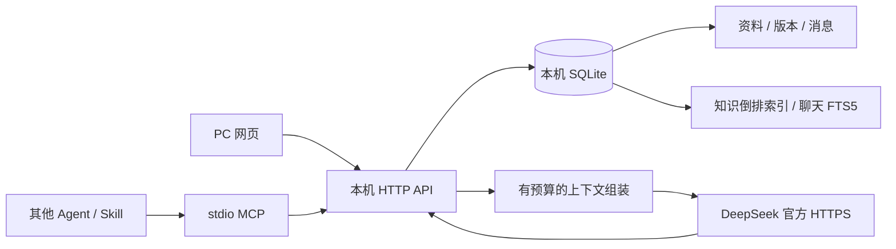

# 星汐：技术方案与性能优化原理

> 本文面向希望把星汐的设计迁移到其他知识库、Agent、聊天工具或本机应用的开发者。对应当前已经实现并验证的机制；尚未实现的部分单独列出。测量环境、原始数据和复现入口见 [PERFORMANCE.md](PERFORMANCE.md)。后续迭代应同步更新本文，不能把阶段性的数字解释为“无限记忆”或所有场景的性能承诺。

## 1. 先定义系统要保存什么

星汐同时保存项目资料、可追溯知识和聊天记录，但不把它们混成一种对象。

| 层次         | 保存内容                           | 如何产生                   | 如何用于回答                 |
| ------------ | ---------------------------------- | -------------------------- | ---------------------------- |
| 原始资料     | 用户导入的文字、Markdown、会话摘录 | 显式导入，原文保持不变     | 支持核对引用                 |
| 正式知识     | 有出处、可修订的条目               | 提炼或手工整理后由用户确认 | 只检索 accepted 条目         |
| 会话记录     | 用户与助手的原始消息               | 网页或 MCP 追加            | 当前会话近期上下文           |
| 聊天原话索引 | 历史用户消息的可检索副本           | 与消息写入同一事务         | 同空间跨会话找回有限片段     |
| 派生索引     | 分词、倒排记录、FTS5 数据          | 可由原始存储重建           | 加速查询，不作为唯一事实来源 |

把“保存了消息”和“确认了一条事实”分开非常重要。用户可以说假设、否定句或虚构测试，助手也可能出错。索引应保留原话、角色、出处和时间，不能因为模型总结了一遍就把它当作用户事实。

## 2. 整体结构



网页和 MCP 必须经过同一层业务服务。两套客户端如果各自维护数据库、摘要或消息 ID，就很容易出现“网页记得，Agent 不记得”的问题。

当前源码对应关系：

- `server/store.mjs`：数据读写、事务、知识索引、游标分页、稳定会话绑定。
- `server/conversation-memory.mjs`：聊天全文索引、原话召回、空间与会话开关。
- `server/reply-evidence.mjs`：回答参考快照、按需审计读取与删除传播，不进入记忆检索。
- `server/workspace-views.mjs`：有界页面摘要、目录全文索引、复合游标、来源字数缓存和按需详情。
- `server/service.mjs`：模型请求、上下文预算、消息重试、资料提炼任务。
- `server/http.mjs`：回环监听、认证、跨站检查、API 与静态页面。
- `server/mcp.mjs`：将 MCP 工具映射到同一个本机 API。
- `src/Graph.jsx`、`src/graph-layout.js`：有绘制上限的星图。

## 3. 为什么原来慢：请求做了与任务无关的工作

性能问题往往不在模型，而在调用模型之前。

原先部分路径会先读取所有条目，再在 JavaScript 中匹配；读取一个会话会返回全部历史；追加一条消息也会间接读取整段历史。结果是：数据越多，每个小操作都越来越贵。

一次请求的成本可以拆为：

```text
总耗时 = SQL 扫描与读取
       + 对象创建与解析
       + JSON 序列化
       + 传输与前端解析
       + 页面布局与绘制
       + 模型网络与生成（仅模型请求）
```

只给 SQL 加索引，无法解决“仍返回几 MB JSON”的问题；只减少返回条数，却先把全部消息读入内存再切片，也没有消除读取成本。优化必须从数据库查询一直贯穿到页面绘制。

## 4. 知识检索：把重复计算提前到写入阶段

### 4.1 倒排索引

当前知识检索使用 SQLite `entry_terms`：

```text
(space_id, term, entry_id, weight)
```

英文按完整词和数字分词；中文生成单字与连续双字。例如“纸舟计划”会生成“纸舟、舟计、计划”，索引中另有单字，以支持单字查询。标题权重高于正文。

以前：

```text
每次提问 → 读取 N 条完整正文 → 分词/匹配/打分 → 排序 → 取少数结果
```

现在：

```text
确认或修改条目 → 更新这个条目的倒排记录
每次提问 → 分词 → 数据库查询匹配 postings → 读取少数结果
```

选择性强的查询只访问少量候选，因此会明显变快。但高频词的 postings 仍可能很大，不能声称所有检索都是 O(1)。

### 4.2 索引和状态必须一致

条目确认、修改、归档及倒排更新放在同一事务中。失败时一起回滚，避免出现“界面已经归档，但模型还在召回”的状态。

索引可重建。旧数据库第一次升级时回填一次，并写迁移标记；后续启动不再全量重建。当前迁移仍是同步执行，超大数据库需要进一步做分批迁移或后台重建。

### 4.3 何时迁移到其他工具

适用于精确术语、项目代号、函数名、用户原话、中文实体等检索。它不擅长同义改写和隐含语义。需要语义召回时，可以增加本地 embedding，但应保留原文、作用域、删除传播和可重建原则，不能只留下向量。

## 5. 聊天留存：共享空间，稳定会话，有界召回

### 5.1 两个标识分别解决不同问题

- `spaceId`：决定从哪一组知识和聊天中检索。
- `sessionId`：决定把消息追加到哪一段具体会话。

同空间的新会话能够检索允许召回的历史用户原话。若需要继续同一段聊天，复用 `sessionId`。外部 Agent 不方便长期保存 ID 时，可使用：

```json
{
  "spaceId": "目标空间 UUID",
  "binding": "my-companion-main"
}
```

将它传给 `session_open`。数据库以 `(space_id, binding)` 唯一约束恢复或创建会话。不同客户端约定同一绑定，即可恢复同一记录；绑定不是密码，也不应包含密钥。

### 5.2 自动聊天记忆不需要额外模型请求

用户消息写入时同步分词并写入 FTS5。检索使用空间专用 token 限定范围，同时再次检查数据库中的空间归属；空间或会话关闭召回后，在查询层立即排除。

当前每轮回答最多选择 6 条相关原话和 2 条近期原话，排除已经在近期上下文中的消息；每条原文片段最多 1,200 字符，并保留消息 ID、会话 ID、时间与截断标志。

这是“原话检索”，不是后台自动总结。好处是没有额外模型费用、不会因每轮摘要不断改写事实；局限是不能替代对全部历史的理解，目前也不会把助手的旧方案自动压缩成跨会话摘要。

### 5.3 固定上下文预算

当前模型输入由以下部分组成：

1. 当前空间的表达设定。
2. 有限的相关已确认知识及偏好、约定。
3. 最多 8 条历史用户原话。
4. 当前会话最近最多 20 条消息，并限制约 20,000 字符。

保存量可以增长，单次模型输入不能随历史无限增长。字符预算只是粗略上限，不等于精确 token 计数。迁移到不同模型时应按实际 tokenizer 和上下文窗口重新设定。

### 5.4 重试不是再写一遍

每条请求带调用方生成的 `clientId`，数据库用 `(session_id, client_id)` 去重。同一请求重试复用原标识；不同内容复用同标识则拒绝。

生成失败时保留真实用户消息，不伪造助手回复。模型成功后持久保存回答，再返回结果。网络重试命中已完成回答时不再次调用模型。当前单进程内还为同一会话设置生成锁，避免回复交错。

## 6. 会话性能：数据库分页，不是前端切片

Web/MCP 读取最新最多 100 条消息。继续向前读取时使用上一页给出的序号游标：

```sql
SELECT rowid AS sequence, *
FROM messages
WHERE session_id = ? AND rowid < ?
ORDER BY rowid DESC
LIMIT ?;
```

先在 SQL 层限制读取，再把这一页翻转成正序展示。新消息追加不会把此前的游标页面推移，避免大 OFFSET 的重复跳过成本。

这里的 `rowid` 只作为当前数据库的分页定位，不是可跨导入、重建数据库使用的永久业务 ID。真正的消息身份仍是 UUID。更复杂的同步系统应使用显式、不可复用的递增序号或复合游标。

另一个容易忽略的问题是导出语义：页面只显示一页，不意味着只保存了这一页。“收为资料”在服务端读取完整会话，超过大小上限则明确拒绝，不能悄悄截断成不完整资料。

## 7. 图谱性能：限制绘制成本，并减少重复扫描

如果在排序比较器里反复扫描所有关系，排序每比较一次就再次统计节点度数，成本会接近 O(N log N × E)。

当前做法：

1. 一次遍历关系，得到每个节点的度数，O(E)。
2. 排序节点，O(N log N)。
3. 选取最多 160 个节点。
4. 仅保留所选节点之间最多 500 条关系。
5. 用 memoization 避免输入未改变时重复准备。

总体准备成本大致为 O(E + N log N)。现在服务端先按更新时间/ID 取当前页最多 160 个节点及其间最多 500 条关系，前端的 N、E 也有上限；页内再按关系度组织，不是全库中心度排名。翻页与全文筛选可找到未显示节点，更大规模仍需要聚类和逐层展开。

## 8. 减少搬运：正文懒加载与不重叠的轮询

原始来源正文不放入空间快照；首次只返回标题、来源类型、时间、字符数。点击来源时再读正文。原文完整性不变，变化的是读取时机。

资料提炼期间只轮询任务状态，不每两秒下载整个空间。一个请求结束后再安排下一次，而不是使用可能堆叠的固定 interval；页面隐藏时暂停检查，任务完成后再刷新内容。

迁移到其他工具时，先区分：

- 首屏需要的摘要字段；
- 用户点击后才需要的正文；
- 仅导出或核对时才需要的历史。

这一项已在第二阶段修正：网页改用 /view 接口，星册每页取 60 条、正文仅返回 240 字符预览；星历每页 40 个事件，来源和会话列表每页 50 条。兼容快照仍保留给旧接口与诊断，网页不再调用。目录全文索引覆盖原文，详情和证据另行加载；编辑器必须加载完整正文并保留打开时的 revision，不能将预览保存回数据库。

## 9. 安全边界与性能一起设计

### 外发边界

应用运行时只有模型调用会向 DeepSeek 官方 HTTPS 接口发送必要内容。地址固定，拒绝重定向；Key 只用于认证，不出现在状态返回和错误原文中。

网页 CSP 只允许同源连接，Markdown 不执行 HTML、禁止图片加载；MCP 仅连接回环地址，将 localhost 固定为 127.0.0.1，拒绝重定向。没有后台遥测、远程字体或其他资料上传接口。

这不等于对整台电脑施加防火墙。用户主动打开外链、安装依赖和开发时向 GitHub 推送源码是另外的操作。第三方 Agent 自己的网络行为也不由星汐控制。

### 本机访问

服务只监听 127.0.0.1；Web 使用 HttpOnly / SameSite cookie，MCP 使用本机令牌。API 校验 Host、Origin 与跨站请求标记。私有数据库、Key 和令牌放在被 Git 忽略的 `.local` 中。

这是可信单用户环境的设计。空间隔离是业务边界，令牌拥有者仍能访问整个实例，不能把它误当成多租户授权。

### 删除传播

删除会话时，同一事务删除消息及固定绑定，数据库触发器同步清理 FTS 索引。已经手工导出的资料是独立快照，不会自动删除。逻辑删除也不等于擦除备份或保证磁盘不可恢复。

### 请求处理

HTTP 正文先累计字节并检查上限，再统一 UTF-8 解码，避免汉字被分在两个网络块时损坏。错误响应不回显原始凭证、模型错误正文或完整请求，避免日志变成另一份私密数据库。

## 10. 如何理解当前的测量结果

基准环境为 Apple M4 / Node 26.4.0 / 本机 SQLite；5,000 条知识、50 份资料、10,000 条消息，全部为合成数据。

| 指标                   |        早期对照 |   首轮优化后 |
| ---------------------- | --------------: | -----------: |
| 选择性知识检索中位耗时 |        58.32 ms |      0.13 ms |
| 会话读取中位耗时       |        50.11 ms |      0.37 ms |
| 消息追加中位耗时       |        71.32 ms |      0.20 ms |
| 会话响应体             | 5,282,951 bytes | 54,663 bytes |

新增聊天全文索引后，单独一次运行测得：选择性聊天检索 0.39 ms，高频词 12.16 ms，近期原话 0.16 ms，带索引的消息追加 0.34 ms，均为中位数。

这些改进主要来自“每个请求做更少的工作”，不是更换硬件，也不是把模型推理加速了几百倍。会话响应体下降是分页的结果，不能解释为丢弃了旧消息。

每项重复 15 次，空间快照仅 5 次。这样的 p95 接近样本最大值，不能当成可靠的生产长尾分布。热缓存、重复文本、选择性查询都会影响结果；冷启动、首次回填、真实浏览器绘制与模型网络延迟不在这些数字中。

首轮优化后的反例是：空间完整快照仍约 4.18 MB，另一轮中位耗时为 133.12 ms，高于先前约 67 ms 的观测。这促成了第 13 节的页面分页改造；网页如今不再依赖完整快照。保留这些历史结果，是为了说明单一漂亮数字不能掩盖全量读取和机器负载变化。

复现命令：

```sh
npm ci
npm run check
npm run benchmark
npm run benchmark -- --baseline=perf-baseline
```

基准脚本在临时目录造数并清理，不读取真实 `.local`，不调用模型。对照需要完整 Git 历史与 `perf-baseline` 标签。CI 检查正确性和结构上限，不把某台机器的毫秒值写成跨硬件的硬性断言。

## 11. 迁移到其他工具的实施顺序

1. 先列出每种请求真正需要的字段，记录 SQL 行数、响应字节和端到端时间。
2. 找出“追加一条却读全部”“列表返回全文”“排序时反复查关系”等增长路径。
3. 明确原文、事实、摘要和索引的职责，保证索引可重建。
4. 在数据库层加作用域、索引、LIMIT 与稳定游标，避免读完再切片。
5. 统一网页、MCP 和其他入口的存储与业务逻辑，建立会话绑定及重试标识。
6. 给模型输入、页面绘制、任务并发和单次资料大小都设预算。
7. 同时实现修改、归档、关闭、删除的索引传播，再讨论缓存。
8. 使用高频词、长消息、重复重试、跨空间、重启迁移等场景测试，不只挑最容易命中的查询。
9. 在确认结果正确后再比较性能，记录硬件、数据分布、冷热缓存、样本量与未覆盖项。

## 12. 尚待完善

- 已完成页面摘要与各列表服务端分页；后续继续关注大库迁移、极高出度关系和高频词查询。
- 增加有出处、区分说话角色的长会话摘要，以及纠正与时间冲突的审阅机制。
- 已完成每轮参考记录持久化与删除传播；后续补齐备份、恢复和大库迁移体验。
- 扩展真实模型回归和大规模数据测试，同时继续保持“除模型外无其他运行时对外 HTTP 请求”的边界。

上述内容是未完成项，不是当前已经具备的功能。最终交付前应逐项重新核对代码、测试、运行状态和本文。

## 13. 第二阶段：消除页面全量读取的可迁移细节

### 13.1 一个 LIMIT 不足以保证快

列表 SQL 即使只取 50 行，若执行 length(body)，仍可能触碰 50 份长原文。星汐用 source_metrics 缓存字数，在 INSERT/UPDATE 数据库触发器中更新，列表只联结短字段。缓存可由原文重建，更新语义由数据库维护。

同样，时间线使用 `SELECT 'entry:' || id AS id ... ORDER BY id` 时，ORDER BY 解析成拼接别名，可能失去原有索引的完整有序访问。显式改为 `ORDER BY entries.updated_at DESC, entries.id DESC`，先取有界元数据，再拼接与合并，避免相同时间事件的额外排序。

应查看实际 EXPLAIN QUERY PLAN，确认使用覆盖索引或有序索引，不能只确认“表上存在索引”。特定 SQLite 版本的计划文本也不是跨版本唯一的正确性证明。

### 13.2 混合时间线无需全量 UNION 后排序

分别从来源和知识两个索引读取 pageSize + 1 条，应用层只合并至多两页元数据，再取前 pageSize 条。类型前缀和 UUID 作为同一时间下的稳定排序项，避免并列时间戳漏记录。内存和传输成本与页面大小相关，而非全部正文体积。

### 13.3 查询数据和展示数据分开

目录检索保存完整文本分词，页面只返回摘要。关键词即使在原文末尾、未进入 240 字符 preview，也能命中并点开全文。目录覆盖所有状态，UI 按状态过滤；模型知识召回仍只看 accepted。浏览索引不能意外扩大模型可使用的正式事实集合。

### 13.4 本轮实际收益

同一合成数据集：5,000 条知识、50 份资料、10,000 条消息、实际入库的 10,000 条关系。当前兼容快照为 5,396,347 字节，中位耗时 90.06 ms；每页读取后，星册为 46,253 字节 / 1.41 ms，星图为 122,835 字节 / 2.73 ms。其余页面及测量边界见 PERFORMANCE.md。

这是请求粒度改变带来的收益，不能宣传成“同样完整数据传输快了几十倍”。数据仍在数据库，需要时通过翻页或详情接口获取。

### 13.5 前端也要保护正确性

搜索延迟 250 ms，减少连续键入请求；响应返回时核对空间、视图、筛选、游标和请求序号，忽略过期结果。切换页面重置无关搜索条件。旧详情不能出现在新空间，后台刷新不应卸载编辑中的表单，或替换保存时使用的 revision。

数据库分页限制读取，摘要限制传输，按需详情保留完整性，事务与版本号保留正确性。这些机制共同组成可迁移到其他工具的方案。

## 14. 在另一个工具中如何落地

先按访问模式迁移机制，不必照搬星汐的页面名称和技术栈。

| 新工具的场景         | 优先复用的机制                                     | 必须验证的条件                                 |
| -------------------- | -------------------------------------------------- | ---------------------------------------------- |
| 项目 Wiki / 文档管理 | 全文索引与列表摘要分开，点击再读正文               | 摘要以外的词能搜到，修改和归档及时生效         |
| Agent 长期记忆       | 统一存储入口、空间隔离、稳定会话绑定、有界原话召回 | 新会话与 MCP 能找回同一出处，假设和否定仍保留  |
| 日志 / 消息列表      | 数据库游标分页，追加操作不读取历史                 | 同时间记录不遗漏，新插入不扰乱已读页，导出完整 |
| 图谱 / 可视化        | 服务端有界子图、一次计算度数、绘制数量上限         | 只展示真实边，页外节点仍可检索，截断可见       |
| 本机桌面工具         | 本机持久化、按需详情、写入时维护派生元数据         | 重启可恢复，索引可重建，外部请求符合既定边界   |

### 14.1 可迁移的查询模板

以下是原理模板，表名和字段应按目标项目修改。分页排序字段必须和索引、游标条件一致；若需要固定历史视图，应额外设计快照版本，普通游标不提供这种保证。

```sql
CREATE INDEX item_page ON items(scope_id, status, updated_at DESC, id DESC);

-- 首页省略最后的游标条件；读取 page_size + 1 条来判断是否还有下一页。
SELECT id, title, preview, updated_at
FROM items
WHERE scope_id = :scope AND status = :status
  AND (updated_at < :last_time
       OR (updated_at = :last_time AND id < :last_id))
ORDER BY updated_at DESC, id DESC
LIMIT :page_size_plus_one;
```

`preview` 可以是写入时维护的短字段，也可以像星汐当前目录一样用 `substr(body,1,240)` 计算。两者的读取成本并不完全相同，长正文很多时应分别测量。不要对每行执行无必要的全文解析，也不要为了取标题再次调用详情接口形成 N+1 查询。

```text
一次写入事务：
  校验作用域与预期 revision
  写正文 / 消息 / 新版本
  更新相应索引与派生元数据
  提交；任何一步失败则一起回滚

一次页面请求：
  校验作用域与游标
  数据库读取一页摘要
  返回 items + hasMore + nextCursor
  用户点开某项时，再读取这一项的完整内容

一次模型请求：
  幂等保存本轮输入
  取有限近期上下文 + 有限相关证据
  在输入预算内组装，标明来源与角色
  调用模型，保存真实返回后再交付
```

### 14.2 迁移后的验收记录

为每条关键路径记录：数据量与分布、查询条件、数据库执行计划、返回行数、JSON 字节、耗时中位数和尾部样本。若声称提升页面体验，还要单独测浏览器解析、绘制和交互；若声称降低内存，必须测峰值内存，不能仅凭响应变小推断具体降幅。

先比较相同输入与相同输出的实现；若优化改变了请求粒度（例如全文改分页），分别报告“每次请求成本”和“获取全部数据的成本”。增加索引通常会增加写入成本和磁盘占用，写入压测、索引体积、初次迁移和删除传播都应纳入目标工具的复测。

最终应能回答三个问题：减少了哪一类重复工作，代价转移到了哪里，哪些情况下收益会下降。能解释并复现这些结果，才算完成可迁移的性能优化。

## 15. 有界审计：知道一次回答参考了什么

只在前端保存“本轮召回结果”，刷新后就会丢失；事后重新检索又可能命中新版本或不同片段，无法代表当时的输入。因此星汐在构建模型输入时捕获参考快照，并在回答成功后与消息一起写入本机事务。

三个层次采用不同存储方式：知识存当时版本及提供给模型的有限正文/出处摘录，跨会话原话存最多 1,200 字符片段，当前会话近期上下文只存消息 ID、角色与时间。最多分别 8、8、20 项。记录不含 Key，不复制整个提示词，也不是模型推理过程或“实际引用证明”。只有星汐自己生成的新回答有此记录，旧消息和其他 Agent 手动追加的回答不能事后补造。

性能关键是按回答主键读取，不给会话的每条消息自动附带所有参考。页面点击时才调用详情接口，MCP 使用同一接口。更新和归档不会改写当时的知识快照；关闭原话召回会在读取时隐藏对应内容，删除原会话会通过 target_id 索引定位并清空其他记录中的原话 payload。模型调用进行中若来源会话被删除，保存时再次检查存在性，不把内存中的旧片段重新写回数据库。

审计记录不能再进入召回，否则它会重复放大旧说法，形成“模型看过一次，就处处都是这个结论”的反馈循环。删除传播是存储模型的一部分，不能只在界面隐藏。删除不会自动改写已经生成的其他回答或擦除独立备份。

复测命令 `npm run benchmark -- --evidence` 会建立 5,000 份合成参考记录、每份 36 项。Apple M4 / Node 26.4.0 的后一轮测试中，单份读取与 JSON 序列化中位 1.98 ms，回答和参考一起写入中位 5.24 ms；每份响应 14,442 字节，填充这些记录使数据库逻辑页增长 75,849,728 字节。前一轮同机观测分别 1.03 ms / 3.11 ms，说明机器负载与缓存会影响数字；不能用最好一次作为保证。两轮都是 15 个计时样本，不包含模型请求。测试正文较短且重复，不代表最大输入长度的存储上限。

可迁移原则是：长期保存审计需要磁盘；用有界快照、近期原文引用和按需读取控制代价，同时给出实测存储增长。不要把“查询只需几毫秒”宣传为“留存没有成本”。
